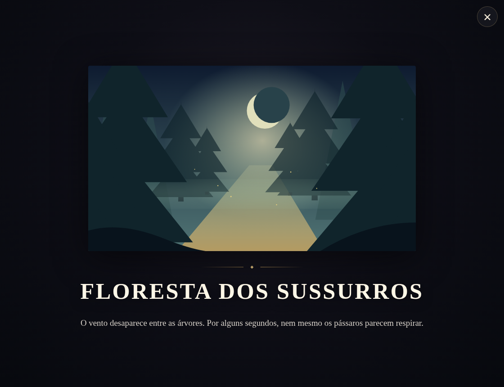

# Ardonia Cinematic

Extensão independente para o **Owlbear Rodeo**. Prepare descobertas de áreas, encontros com chefes e revelações; durante a sessão, clique em **Anunciar** para apresentar imagem, título e descrição aos participantes conectados.

O anúncio usa fundo escuro, imagem sem deformação, título expressivo e animação discreta. Não há peso, categoria, equipamentos ou estatísticas. A descrição e a imagem são opcionais. Cada cena tem uma duração própria. Nos dois segundos finais, a imagem e os textos escurecem suavemente. Ao fim do prazo, o modal se fecha e o participante volta ao mapa.

## O que está incluído

- **Banco de Cinematics do Mestre**: criar, editar, duplicar, excluir, pesquisar e reutilizar apresentações.
- Prévia local antes do anúncio.
- Broadcast pelo SDK oficial e receptor em segundo plano em cada cliente.
- Biblioteca privada neste navegador, com exportação e importação de backup JSON.
- Layout adaptável, prévia com fechamento manual e suporte à preferência de redução de movimento.
- Som de entrada original, controle individual de ativação/volume e efeitos por URL HTTPS, gerais ou por cinematic.
- Código TypeScript, testes automatizados, build estático e configuração de GitHub Pages.

A implementação foi escrita do zero. A extensão Inventário — Ordem Paranormal serviu como referência de comportamento; não foram copiados código, imagens, ícone ou áudio. Veja a [investigação](docs/investigacao.md).

## Como usar na sessão

1. Instale a extensão na sala conforme as instruções abaixo e abra **Ardonia Cinematic** na barra de extensões.
2. Entre como **mestre (GM)**. O banco de gerenciamento é reservado ao mestre.
3. Clique em **Nova cinematic**, informe um título e, se desejar, uma descrição e uma URL de imagem HTTPS. Também é possível usar **Escolher no Owlbear** para abrir o seletor oficial de imagens.
4. Em **Duração da apresentação**, escolha **8, 10, 12, 14, 16 ou 20 segundos**. O padrão é **14 segundos**. Use **Pré-visualizar** para conferir a composição, feche a prévia com o X ou Esc e salve.
5. Pesquise pelo título ou descrição no banco e clique em **Anunciar** na cena desejada.
6. Cada participante, incluindo o mestre, vê a cena durante o tempo escolhido a partir da renderização em seu dispositivo. Em uma cena de 8 segundos, por exemplo, o fade começa aos 6 segundos e o modal fecha aos 8. Anunciar outra cena durante a exibição substitui a anterior e inicia um novo prazo completo.

O X fica na prévia local. Se o Owlbear falhar ao fechar um anúncio, a extensão tenta de novo e oferece um botão de recuperação para aquela apresentação. Ao retornar de uma aba suspensa, o cliente confere se o prazo já venceu.

Os participantes precisam estar na mesma sala e com a extensão habilitada. O painel do jogador não precisa permanecer aberto: o receptor roda no background da extensão. Participantes que entrarem depois não recebem anúncios antigos; anuncie novamente quando necessário. Um envio pelo SDK confirma o envio, não a leitura em todos os aparelhos.

## Som de entrada

Mestre e jogadores podem abrir **Som de entrada** e clicar em **Ativar som**, ajustar o volume e testar. O som começa desativado. O mestre pode salvar outro efeito geral por URL HTTPS ou definir um efeito específico no editor de uma cinematic; todos recebem a escolha efetiva, respeitando o silêncio e o volume de cada participante.

O padrão é um impacto original de 0,95 segundo. Áudios personalizados podem ser MP3, WAV ou OGG suportado pelo navegador, públicos com CORS, até **1 MiB e cinco segundos**. Para usar um arquivo local, primeiro hospede-o: não há upload nem transmissão de arquivos no broadcast. **Voltar ao efeito padrão** restaura o impacto original.

Durante o anúncio, a tela mostra a imagem, o título, a descrição opcional e os ornamentos. As opções de áudio ficam em **Som de entrada**, no painel principal. O fade e o fechamento seguem a duração visual mesmo com o som bloqueado ou desativado.

Clique em **Ativar som** e aguarde **Pronto nesta sessão**; então pode fechar o painel e anunciar várias vezes. Fechar uma apresentação mantém o mesmo contexto persistente para a seguinte. Se o navegador bloquear o áudio, confira o aviso no painel, autorize o som do site e tente ativar novamente ali. A cena visual continua funcionando e não ganha novos controles. Autoplay não é universal, especialmente no iOS.

O background impede um segundo proprietário da mesma implantação no participante. Testes e anúncios na sala usam esse mesmo reprodutor: uma nova reprodução interrompe a anterior, mantendo o ganho escolhido e o WAV original. Veja [as medições de volume](docs/volume-validation.md) e suas limitações.

[Instruções, restrições e pesquisa de áudio](docs/audio.md).

## Imagens, privacidade e backups

Use o endereço direto de uma imagem acessível por **HTTPS**, não o endereço de uma página que contém a imagem. A imagem precisa poder ser carregada pelos navegadores dos jogadores; URLs que exigem sua conta ou expiram podem falhar para eles. Uma falha de imagem não impede a exibição do título e da descrição. O botão **Escolher no Owlbear** abre o seletor oficial. URLs de recursos selecionados também podem ser privadas ou temporárias; verifique o acesso com um jogador e prefira links duráveis. Não há upload para um servidor próprio do Ardonia.

A biblioteca fica no `localStorage` deste navegador e desta origem de hospedagem. **Não existe sincronização entre computadores, celulares ou navegadores.** Limpar os dados do navegador, usar navegação privada ou trocar a URL/origem da hospedagem pode tornar a biblioteca indisponível. Exportar um backup antes dessas mudanças é essencial. O aplicativo informa falhas de gravação; não considera um salvamento concluído quando o armazenamento falha.

- **Exportar backup** baixa um arquivo JSON com a biblioteca, incluindo a duração de cada cena. Cenas e backups anteriores a 1.2.0 usam 14 segundos até o mestre escolher outro valor.
- **Importar backup** lê e valida esse arquivo antes de gravar, mesclando cenas por ID. Havendo IDs já existentes, a interface pede confirmação antes de substituí-los; as demais cenas são mantidas.
- Guarde uma cópia do backup fora do navegador e faça uma nova exportação após preparar a sessão.

O formato de backup é `ardonia-cinematic`, versão `1`. São aceitas até 500 cenas e arquivos de até 2 MiB; títulos têm até 180 caracteres, descrições até 6.000 e URLs até 2.048. Cada anúncio tem um limite adicional de 15.000 bytes UTF-8; textos com muitos caracteres multibyte podem exigir redução antes de anunciar. Esses são limites do aplicativo, não uma quota garantida pelo SDK. O limite efetivo de armazenamento do navegador pode ser menor. Não importe arquivos recebidos de fontes em que não confia sem conferir as imagens externas que eles referenciam.

O ícone e a ilustração `cena-floresta.svg` são recursos originais do projeto. Para experimentar uma imagem, use a URL pública dessa ilustração na sua hospedagem.

A biblioteca inteira não é enviada à sala. O anúncio transmite somente a cena selecionada; cada cliente mantém os dados recebidos em memória para abrir o modal. Título e descrição são tratados como texto, não HTML. O servidor de uma imagem externa pode observar as requisições dos participantes.

## Instalar no Owlbear Rodeo

Primeiro, é necessária uma hospedagem pública HTTPS com os arquivos compilados. **Enviar código ao GitHub, publicar um site e instalar a extensão na sala são etapas diferentes.**

Quando o site estiver publicado:

1. Abra no navegador a URL de `manifest.json` fornecida pela hospedagem. Ela deve mostrar o manifesto JSON sem pedir login.
2. Abra sua sala no Owlbear Rodeo e acesse o gerenciamento de extensões da sala.
3. Escolha adicionar uma extensão personalizada por URL e cole a URL completa de `manifest.json`.
4. Confirme a instalação e habilite **Ardonia Cinematic** na sala.
5. Abra o painel como mestre, crie uma cena de teste e anuncie com pelo menos um jogador conectado.

A nomenclatura dos menus pode variar conforme atualizações do Owlbear Rodeo. Não use uma URL de arquivo da interface do GitHub, como `github.com/.../blob/.../manifest.json`: ela serve uma página do GitHub, não a extensão hospedada.

## Publicar com GitHub Pages

O único repositório deste projeto é:

**https://github.com/contanumero5roblox-star/-ardonia-cinematic**

O hífen inicial em `-ardonia-cinematic` faz parte do nome e deve ser mantido em todos os caminhos.

### Repositório privado e plano da conta

A documentação do GitHub disponibiliza Pages para repositórios privados nos planos **GitHub Pro, Team e Enterprise**. No plano Free, Pages está disponível para repositórios públicos. A existência do repositório privado não comprova que a conta tem um desses planos; verifique em **Settings → Pages** do repositório se a opção está disponível.

Em uma conta pessoal, o site Pages é público mesmo quando o repositório de origem é privado. Isso é necessário para os participantes carregarem a extensão sem autenticação no GitHub. A biblioteca local não é publicada junto com o site. Não coloque segredos ou imagens confidenciais entre os recursos estáticos do projeto.

### Passo a passo

1. Abra o repositório no GitHub, depois **Settings → Pages**.
2. Em **Build and deployment → Source**, escolha **GitHub Actions**.
3. Vá à aba **Actions** e habilite os workflows, se o GitHub solicitar.
4. Execute manualmente o workflow de publicação Pages na branch `main`, usando **Run workflow**.
5. Aguarde o job de publicação terminar com sucesso. Se o ambiente `github-pages` exigir aprovação, aprove a execução na interface do GitHub.
6. Volte a **Settings → Pages** e use a URL que o próprio GitHub mostrar.
7. Abra `<URL-do-site>/manifest.json` e só então use esse endereço no Owlbear Rodeo.

No domínio padrão, a URL esperada é:

```text
https://contanumero5roblox-star.github.io/-ardonia-cinematic/manifest.json
```

**Esse é um endereço esperado, não uma afirmação de que o site já está publicado ou funcionando.** O estado real de publicação e de testes está no [relatório de validação](docs/validacao.md). Use a URL apresentada pelo GitHub caso ela seja diferente.

### Alternativa se Pages não estiver disponível

É possível manter o repositório privado e hospedar somente o build em um serviço estático HTTPS, como Netlify. Para hospedar na raiz de um domínio, gere o build com `ARDONIA_BASE_PATH=/ npm run package` (no PowerShell: `$env:ARDONIA_BASE_PATH="/"; npm run package`). O ZIP padrão usa o prefixo Pages `/-ardonia-cinematic/`; se usar esse ZIP sem recompilar, mantenha esse subdiretório na hospedagem. Extraia o ZIP de publicação e publique o conteúdo da pasta compilada: `index.html`, `background.html`, `presentation.html`, `manifest.json`, ícone e diretório de assets precisam preservar seus caminhos relativos. Em uma publicação manual por arrastar e soltar, selecione a pasta que contém `index.html` diretamente, não o ZIP de código-fonte.

O site precisa ser acessível sem login e permitir incorporação em iframe pelo Owlbear Rodeo; cabeçalhos `X-Frame-Options: DENY`/`SAMEORIGIN` ou uma política `frame-ancestors` restritiva podem impedir o funcionamento. Confira o manifesto e os recursos no endereço final. Essa alternativa não exige criar outro repositório. A publicação em um provedor externo depende da conta e das configurações desse provedor.

## Desenvolvimento e testes

Requisitos: Node.js **22.12 ou superior**, npm e Python 3 para gerar os ZIPs.

```bash
npm ci
npm run dev
```

Fora de um iframe autorizado do Owlbear Rodeo, o painel funciona como editor e prévia local. Ele informa que não está conectado à sala e não simula um anúncio multiplayer bem-sucedido. Para testar a integração real, sirva a extensão em HTTPS e instale seu manifesto em uma sala de teste.

```bash
npm test             # testes unitários e de integração da lógica
npm run build        # TypeScript, build de produção e verificação de dist
npm run test:e2e     # testes de navegador (SDK simulado quando indicado)
npm run check        # sequência de verificação
npm run preview     # servir o build localmente
npm run package     # build e ZIPs em artifacts/
```

Os testes de navegador usam Playwright. Instale o navegador exigido pelo runner com `npx playwright install chromium` se ele não estiver disponível na máquina. O runner usa `CHROMIUM_PATH` quando definido, depois `/usr/bin/chromium` se disponível e, por fim, o navegador instalado pelo Playwright.

Os testes automatizados locais não comprovam a entrega em uma sala real nem o comportamento em aparelhos físicos. Consulte [docs/validacao.md](docs/validacao.md) para os comandos efetivamente executados, resultados, resoluções testadas e pendências. Para detalhes de comunicação e segurança, veja [docs/arquitetura.md](docs/arquitetura.md).

## Obter os arquivos e atualizar

Os pacotes gerados são:

- `artifacts/ardonia-cinematic-fonte.zip`: código-fonte completo, sem dependências instaladas, caches ou credenciais.
- `artifacts/ardonia-cinematic-publicacao.zip`: somente os arquivos compilados para hospedagem.

Se os ZIPs não estiverem disponíveis para download na conversa, abra **Code → Download ZIP** no GitHub para obter o código-fonte da branch selecionada. Para gerar o pacote de publicação, extraia o código, execute `npm ci` e `npm run package`. Os ZIPs são saídas geradas e não precisam ficar versionados no repositório.

Para atualizar a extensão, faça backup da biblioteca, atualize o código na branch `main`, execute as verificações, ajuste a versão do manifesto e publique um novo build pelo workflow ou pelo provedor escolhido. Mantenha a mesma origem para preservar o armazenamento local. Recarregue a sala e confirme a versão do manifesto; pode ser necessário aguardar o cache da hospedagem. Teste um novo anúncio antes da próxima sessão.

## Licença

O código original do Ardonia Cinematic é disponibilizado sob a [licença MIT](LICENSE). Bibliotecas de terceiros mantêm suas próprias licenças; veja [THIRD_PARTY_NOTICES.md](THIRD_PARTY_NOTICES.md).

### Dependência transitiva corrigida

O SDK 3.1.0 referencia uuid 9; o projeto fixa uuid 11.1.1 por override npm para resolver o alerta GHSA-w5hq-g745-h8pq. O SDK usa a API compatível `v4()` sem argumentos. A versão exata permanece no lockfile e deve ser mantida nas atualizações.

## Aparência

Prévia local com ilustração original (não é captura de sala real):



[Ver a apresentação em tela móvel](docs/screenshots/cinematic-mobile.png).

Na aba **Actions**, o workflow **Verificar extensão** também disponibiliza os ZIPs no artefato `ardonia-cinematic-entrega` após uma execução bem-sucedida. A validação local não afirma que essa execução remota já terminou.
